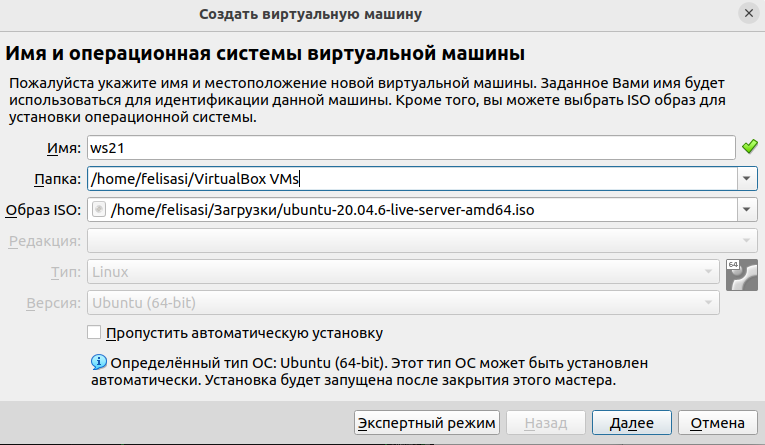
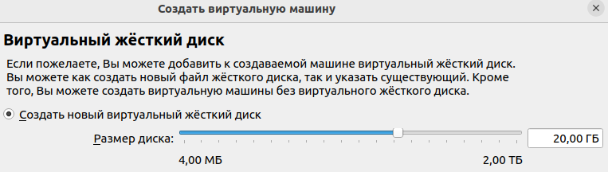
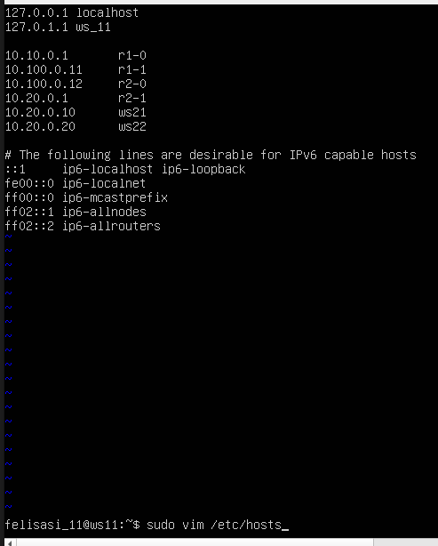

## 1. Инструмент ipcalc
- Поднята виртуальная машина с названием - ws1
  (установлена VirtualBox версии 7 и виртуальная машина по образу `ubuntu-20.04.6-live-server-amd64.iso` взятого `https://releases.ubuntu.com/focal/` см. приложение в конце документа). Выполнены нулевые действия `sudo apt-get update` и `sudo apt-get upgrade`
- Установить ipcalc на ws1 с помощью команды `sudo apt install ipcalc`
\
Рис. 1.1 Вывод команды `sudo apt-get install ipcalc`
- Ввести команду в ws1 `ipcalc 192.167.38.54/13`\
\
Рис. 1.2 Вывод команды `ipcalc 192.167.38.54/13`
### 1.1 Сети и маски
По рис. 1.2 можно определить:
- Адрес сети - 192.160.0.0

    Для того, чтобы определить маску 255.255.255.0 в префиксном и двоичном виде, необходимо еще раз выполнить предыдущую команду, но без явного указания маски подсети. Ниже представлен вывод команды `ipcalc 192.167.38.54`
    \
    Рис. 1.3 Вывод команды `ipcalc 192.167.38.54`\
    По рис. 1.3:
- Маска 255.255.255.0 в префиксном виде - 24;
- Маска 255.255.255.0 в двоичном виде - 11111111.11111111.11111111.00000000.\
  Для того, чтобы определить маску /15 в обычном и двоичном виде, необходимо еще раз выполнить предыдущую команду, но с явным указанием маски подсети. Ниже представлен вывод команды `ipcalc 192.167.38.54/15`
\
Рис. 1.4 Вывод команды `ipcalc 192.167.38.54/15`
- Маска /15 в обычном виде - 255.254.0.0;
- маска /15 в двоичном виде - 11111111.1111111 0.00000000.00000000.\
Для того, чтобы определить маску 11111111.11111111.11111111.11110000 в обычном виде, необходимо посчитать количество единиц. Префиксная форма определяется выполнением команды `ipclac 192.167.38.54/28`\
\
Рис. 1.5 Вывод команды `ipcalc 192.167.38.54/28`
- Маска 11111111.11111111.11111111.11110000 в обычном виде - 28;
- Маска 11111111.11111111.11111111.11110000 в префиксном виде - 255.255.255.240.\
Для того, чтобы определить минимальный и максимальный хосты в сети 12.167.38.4 при масках: /8, 11111111.11111111.00000000.00000000, 255.255.254.0 и /4, необходимо представить маску в десятичном виде. Т.к. /8 уже представлена в десятичном виде, можно выполнить команду `ipcalc 12.167.38.4/8` и определить хосты.
\
Рис. 1.6 Вывод команды `ipcalc 12.167.38.4/8`
- Минимальный хост в сети 12.167.38.4/8 - 12.0.0.1;
- Максимальный хост в сети 12.167.38.4/8 - 12.255.255.254.\
Для перевода маску 11111111.11111111.00000000.00000000 в обычный вид нужно посчитать количество единиц. После этого можно выполнить команду `ipcalc 12.167.38.4/16`\
\
Рис. 1.7 Вывод команды `ipcalc 12.167.38.4/16`
- Минимальный хост в сети 12.167.38.4/16 - 12.167.0.1;
- Максимальный хост в сети 12.167.38.4/16 - 12.167.255.254.\
Для определения следующих хостов нужно выполнить команду `ipcalc 12.167.38.4/255.255.254.0`
\
Рис. 1.8 Вывод команды `ipcalc 12.167.38.4/255.255.254.0`
- Минимальный хост в сети 12.167.38.4/255.255.254.0 - 12.167.38.1;
- Максимальный хост в сети 12.167.38.4/255.255.254.0 - 12.167.39.254.\
Для определения следующих хостов нужно выполнить команду `ipcalc 12.167.38.4/4`
\
Рис. 1.9 Вывод команды`ipcalc 12.167.38.4/4`
- Минимальный хост в сети 12.167.38.4/4 - 0.0.0.1;
- Максимальный хост в сети 12.167.38.4/4 - 15.255.255.254.

### 1.2 localhost

localhost в компьютерных сетях -  стандартное, официально зарезервированное доменное имя для частных IP-адресов, другими словами - компьютер, на котором пользователь работает в данный момент. localhost имеет диапазон ip-адресов 127.0.0.1 — 127.255.255.254.

Таким образом, localhost со следующими ip адресами может существовать: 127.0.0.2, 127.1.0.1, а с такими нет - 194.34.23.100, 128.0.0.1.

### 1.3. Диапазоны и сегменты сетей
- Частный IP-адрес существует в определенных диапазонах частных IP-адресов, зарезервированных Управлением по присвоению номеров в Интернете (IANA), и никогда не должен появляться в Интернете. Частные IP-адреса могут быть в следующих диапазонах:
  - Класс А: 10.0.0.0 – 10.255.255.255;
  - Класс B: 172.16.0.0 – 172.31.255.255;
  - Класс С: 192.168.0.0 – 192.168.255.255.
  
- Публичные IP-адреса могут быть в следующих диапазонах:
  - Класс A: 1.0.0.0 - 9.255.255.255, 11.0.0.0 - 126.255.255.255;
  - Класс В: 128.0.0.0 - 172.15.255.255, 172.32.0.0 - 191.255.255.255;
  - Класс С: 192.0.0.0 - 192.167.255.255, 192.169.0.0 - 223.255.255.255;
  - Класс D: 224.0.0.0 - 247.255.255.255.
  - Класс E: 248.0.0.0 - 255.255.255.254.
- Из перечисленных ниже IP адресов можно использовать в качестве публичного следующие:\
134.43.0.2, 172.0.2.1, 172.68.0.2, 192.169.168.1, 192.172.0.1;
- В качестве частных следующие:\
10.0.0.45, 10.10.10.10, 172.20.250.4, 172.16.255.255, 192.168.4.2.
- Для определения какие IP адресы шлюза возможны у сети 10.10.0.0/18 необходимо выполнить команду `ipcalc 10.10.0.0/18`.
\
Рис. 1.10 Вывод команды `ipcalc 10.10.0.0/18`\
По рис. 9 видно, что у данной сети могут быть хосты (шлюзы) с адресами 10.10.0.1 - 10.10.63.254.\
Учитывая вышеизложенное, возможными IP адресами данной сети (среди 10.0.0.1, 10.10.0.2, 10.10.10.10, 10.10.100.1, 10.10.1.255) являются:\
10.10.0.2, 10.10.10.10, 10.10.1.255.

## 2. Статическая маршрутизация между двумя машинами

- Подняты 2 виртуальные машины - ws1, ws2. Для того, чтобы сохранилось интернет соединение необходимо создать второй сетевой интерфейс. Для этого в Virtual box нужно настроить ОС в части "Сеть", а именно выбрать "Адаптер 2", тип подключения указать "Внутренняя сеть".
\
Рис. 2.1 Вызов и вывод команды `ip a` на машине ws1
\
Рис. 2.2 Вызов и вывод команды `ip a` на машине ws2
- После описания сетевого интерфеса, файл "etc/netplan/00-installer-config.yaml" для машин ws1, ws2 имеет вид, представленный на рис. 2.3, 2.4 соответственно.\
\
Рис. 2.3 Вывод команды `sudo vim /etc/netplan/00-installer-config.yaml` на ws1\
\
Рис. 2.4 Вывод команды `sudo vim /etc/netplan/00-installer-config.yaml` на ws2
- Результат выполнения команды `sudo netplan apply` представлен на рис. 2.5, 2.6 для машин ws1, ws2 соответственно.\
\
Рис. 2.5 Вызов и вывод команды `sudo netplan apply` на ws1\
\
Рис. 2.6 Вызов и вывод команды `sudo netplan apply` на ws2

### 2.1. Добавление статического маршрута вручную
- Для добавления статического маршрута от одной машины до другой и обратно при помощи команды вида `ip r add` нужно на ws1 выполнить команду `sudo ip r add 172.24.116.8 dev enp0s8`, а на ws2 команду `sudo ip r add 192.168.100.10 dev enp0s8`.\
\
Рис. 2.7 Вывод команды `sudo ip r add 172.24.116.8 dev enp0s8` на ws1\
\
Рис. 2.8 Вывод команды `sudo ip r add 192.168.100.10 dev enp0s8` на ws2
- Для проверки соединения необходимо пропинговать соединение командой `ping 172.24.116.8`:\
\
Рис. 2.9 Вывод команды `ping 172.24.116.8 -c 5` на ws1\
\
Рис. 2.10 Вывод команды `ping 192.168.100.10 -c 5` на ws2

### 2.2. Добавление статического маршрута с сохранением

- Для того, чтобы добавить статический маршрут от одной машины до другой с помощью файла "etc/netplan/00-installer-config.yaml" необходимо прописать маршрут. Содержимое данного файла для обеих машин представлен на рис. 2.11, 2.12.\
\
Рис. 2.11 Содержимое файла "etc/netplan/00-installer-config.yaml" машины ws1\
\
Рис. 2.12 Содержимое файла "etc/netplan/00-installer-config.yaml" машины ws2\
Для применения изменений необходимо выполнить команду `sudo netplan apply` для обеих машин.
- Пропинговать соединение между машинами. Результат приведен на рис. 2.13, 2.14.\
\
Рис. 2.13 Вывод команды `ping 172.24.116.8 -c 5`\
\
Рис. 2.14 Вывод команды `ping 192.168.100.10 -c 5`

## 3. Утилита iperf3

### 3.1. Скорость соединения
- 8 Mbps = 1 MB/s;
- 100 MB/s = 819 200 Kbps;
- 1 Gbps = 1024 Mbps.

### 3.2. Утилита iperf3
- Измерить скорость соединения между ws1 и ws2.\
Для этого необходимо установить саму программу iperf3 на обеих машинах, для этого нужно выполнить команду `sudo apt install iperf3` и установить firewall `sudo apt install firewalld`. После этого нужно открыть порт (в данном случае 5201) для пакетов TCP, UDP в брандмауэре командами:\
`sudo firewall-cmd --permanent --add-port=5201/tcp`;\
`sudo firewall-cmd --permanent --add-port=5201/udp`;\
`sudo firewall-cmd --reload`.\
\
Рис. 3.1 Вывод вышеперечисленных команд на ws1\
По окончании работы вышеупомянутых команд нужно запустить на сервере (пусть это будет ws1) команду `iperf3 -s`.
А на клиенте (пусть это будет ws2) нужно сделать запрос командой `iperf3 -c 192.168.100.10`. Ниже представлены выводы этих команд:\
\
Рис. 3.2 Вывод команды `iperf3 -s` на сервере до запроса клиента на ws1\
\
Рис. 3.3 Вывод команды `iperf3 -c 192.168.100.10` на клиенте на ws2, \
  где:\
*192.168.100.10 — адрес клиента;\
*172.24.116.8 — адрес сервера;\
*ID — идентификатор запросов, нужен для ориентирования, если к серверу идет несколько обращений;\
*Interval — промежуток времени в секундах, на протяжении которого выполнялась передача данных\
*Transfer — сколько было передано данных за интервал времени;\
*Bitrate — средняя скорость передачи данных за интервал времени;\
*Retr — количество повторно отправленных TCP-сегментов;\
*Cwnd — одновременно переданных данных.\
\
Рис. 3.4 Вывод команды `iperf3 -s` на сервере после завершения запроса клиента на ws1
## 4. Сетевой экран

### 4.1. Утилита iptables
- Создание файла `sudo vim /etc/firewall.sh`, имитирующий фаерволл, на ws1 и ws2. 
- Содержимое вышеупомянутого файла после добавления правил приведено ниже.\
\
Рис. 4.1 Содержимое файла /etc/firewall.sh машины ws1\
\
Рис. 4.2 Содержимое файла /etc/firewall.sh машины ws2

- Запуск файла на обеих машинах командами `sudo chmod +x /etc/firewall.sh` и `sudo sh +x /etc/firewall.sh`\
\
Рис. 4.3 Запуск команд `sudo chmod +x /etc/firewall.sh` и `sudo sh +x /etc/firewall.sh` на ws1\
\
Рис. 4.4 Запуск команд `sudo chmod +x /etc/firewall.sh` и `sudo sh +x /etc/firewall.sh` на ws2\
Стратегия, примененная для машины ws1 запрещает пинг, т.к. в начале написано запрещающее правило, а в конце разрешающее, а стратегия машины ws2 наоборот разрешает пинг, т.к. в начале написано разрещающее правило, в конце - запрещающее.

### 4.2. Утилита nmap
-  Утилитой "nmap" можно показать, что запущен хост машины, которая не "пингуется" командой `ping`\
\
Рис. 4.5 Результат работы команд *ping* и *nmap* на машине ws1\
Как видно по седующем рис. 4.6 машина ws1 с ip 192.168.100.10 не пингуется.\
\
Рис. 4.6 Результат работы команд *ping* и *nmap* на машине ws2\
При этом из рис. 4.6 видно, что  хост машины ws1 запущен

- Для сохранения дампов образов виртуальных машин при закрытии нужно выбрать "Сохранить состояние машины".\
\
Рис. 4.7 Сохранение результатов машины ws1\
\
Рис. 4.8 Сохранение результатов машины ws2

## 5. Статическая маршрутизация сети

### 5.1. Настройка адресов машин

- Перед включением ws11, ws22 и ws21 настроить сеть, а именно включить "Адаптер2" и выбрать тип подключения "Внутренняя сеть".
- Перед включением r1 и r2 настроить сеть, а именно включить "Адаптер2", "Адаптер3" и выбрать тип подключения Внутренняя сеть.
- Так же необходимо проверить, чтобы MAC-адреса на рабочих станциях и роутерах отличались друг от друга.
- Поднять пять виртуальных машин (3 рабочие станции (ws11, ws21, ws22) и 2 роутера (r1, r2)).
- Настроить конфигурации машин в "etc/netplan/00-installer-config.yaml" согласно сети, приведенной в задании.\
На рисунках 5.1 и 5.2 приведены содержимые файла "etc/netplan/00-installer-config.yaml" для каждой машины и роутера до настройки и после соотвественно.
\
Рис. 5.1 Содержимое файлов "etc/netplan/00-installer-config.yaml" для ws11, ws22, ws21, r1 и r2 до редактирования (по умолчанию, могут быть иные)\
\
Рис. 5.2 Содержимое файлов "etc/netplan/00-installer-config.yaml" для ws11, ws22, ws21, r1 и r2 после редактирования (согласно инструкциям в задании)
- Перезапустить сервис сети командой `sudo netplan apply`.
- Если есть какие-то ошибки, например как у меня, то следует вернуться к редактированию
\
Рис. 5.3 Пример сообщения об ошибки.\
При вводе настроек в файл следует внимательно прорверить все символы, даже не печатные, ведь имеется различие пробелов и знаков табуляции, число пробелов. Так, исправив `adresses` на `addresses` и убрав лишние прорбелы видим:\
\
- Исправленный вариант представлен на рисунке:
\
- Если ошибок нет, то командой `ip -4 a` проверить, что адрес машины задан верно. Также пропинговать ws22 с ws21. Аналогично пропинговать r1 с ws11.\
Для применения изменений необходимо выполнить команду `sudo netplan apply`. Ниже приведены выводы данной команды для каждой машины и роутера.\
\
Рис. 5.6 Выводы команды `sudo netplan apply` для каждой машины и роутера\
Проверка введенных адресов можно проверить с помощью команды `ip -4 a`, т.е. "показать только IP-адреса версии 4 (IPv4)". Ниже приведены выводы данной команды.\
\
Рис. 5.7 Вывод команды `ip -4 a` для ws11\
\
Рис. 5.8 Вывод команды `ip -4 a` для r1\
\
Рис. 5.9 Вывод команды `ip -4 a` для r2\
\
Рис. 5.10 Вывод команды `ip -4 a` для ws22\
\
Рис. 5.11 Вывод команды `ip -4 a` для ws21\
Для того, чтобы пропинговать ws22 с ws21 необходимо выполнить на ws22 команду `ping 10.20.0.10 -c 5` или на ws21 команду `ping 10.20.0.20 -c 5`. Результаты выполнения данных команд приведены ниже на рис. 5.12\
\
Рис. 5.12 Выводы команд `ping 10.20.0.20 -c 5` и `ping 10.20.0.10 -c 5` на ws21 и ws22 соответственно\
Аналогично можно пропинговать r1 с ws11, для этого нужно выполнить на r1 команду `ping 10.10.0.2 -c 5` или на ws11 команду `ping 10.10.0.1 -c 5`. Результаты выполнения данных команд приведены ниже на рис. 5.13\
\
Рис. 5.13 Выводы команд `ping 10.10.0.2 -c 5` и `ping 10.10.0.1 -c 5` на r1 и ws11 соответственно

### 5.2. Включение переадресации IP-адресов

- Для включения переадресации IP, выполните команду на роутерах:\
`sysctl -w net.ipv4.ip_forward=1`\
Вывод данной команды для роутеров приведен ниже.\
\
Рис. 5.14-15 Вывод команды `sysctl -w net.ipv4.ip_forward=1` для роутера r1 и r2 соответсвенно.
- Откройте файл "/etc/sysctl.conf" и удалите символ "#" перед net.ipv4.ip_forward=1
Содержание файла "/etc/sysctl.conf" для обоих роутеров приведено ниже.\
\
Рис. 5.16 Содержание файла "/etc/sysctl.conf" на r1\
\
Рис. 5.17 Содержание файла "/etc/sysctl.conf" на r2

### 5.3. Установка маршрута по-умолчанию
- Для настройки маршрута по-умолчанию (шлюза) для рабочих станций нужно добавить строку "gateway4" в файле конфигураций. Ниже представлены содержимые данного файла каждой машины.\
\
Рис. 5.18-19-20 Содержание файла "etc/netplan/00-installer-config.yaml" на ws11, ws22 и ws21 соответственно
- Вызвать `sudo netplan apply` и `ip r` и показать, что добавился маршрут в таблицу маршрутизации (см. 3-ю строку default ... proto static)\
\
Рис. 5.21-22-23 Вывод команд `sudo netplan apply` и `ip r` на ws11, ws22 и ws21 соответсвенно
- Пропинговать с ws11 роутер r2 (через r1 разумеется) и показать на r2, что пинг доходит, и на r1 тоже проходит. Для этого использовать команду "прослушки":\
`tcpdump -tn -i eth1` (с моём случае `sudo tcpdump -tn -i enp0s8`)\
\
Рис. 5.24 Результат команд `ping 10.100.0.12 -c 5` на ws11 и `sudo tcpdump -tn -i enp0s8` на r1 и r2 (скриншот сделан в моменте исполнения).

### 5.4. Добавление статических маршрутов
- Добавить в роутеры r1 и r2 статические маршруты в файле конфигураций.\
\
Рис. 5.25 Содержание изменённого файла "etc/netplan/00-installer-config.yaml" для r1 и r2 соответсвенно.\
\
Рис. 5.26 Сохраняем (esc, ':wq', enter) и вновь применяем настройки командой `sudo netplan apply`.
- Вызвать ip r и показать таблицы с маршрутами на обоих роутерах.\
\
Рис. 5.27 Вывод команды `ip r` на r1\
\
Рис. 5.28 Вывод команды `ip r` на r2

- Запустить команды на ws11:\
`ip r list 10.10.0.0/[маска сети]` и `ip r list 0.0.0.0/0`.\
\
Рис. 5.29 Вывод команд `ip r list 10.10.0.0/[маска сети]` и `ip r list 0.0.0.0/0` на ws11\
Для адреса 10.10.0.0/18 был выбран маршрут, отличный от 0.0.0.0/0, хотя он попадает под маршрут по-умолчанию, т.к. данный маршрут будет использоваться только тогда, когда не будет подходящих маршрутов (он имеет более низкий приоритет).

### 5.5. Построение списка маршрутизаторов
- Запустить на r1 команду дампа:
`tcpdump -tnv -i enp0s8`.
- При помощи утилиты traceroute построить список маршрутизаторов на пути от ws11 до ws21\

\
Рис. 5.30 Вывод команд `traceroute 10.20.0.10` на ws11 и `tcpdump -tnv -i enp0s8 -c 150` на r1
На рис. 5.30:\
-t - Не печатать временную метку в каждой строке дампа;\
-n - Не конвертировать адреса (адреса узлов, номера портов и т. д.) в имена;\
-v - Подробный вывод. Например, информация о времени жизни (TTL) и типе сервиса (ToS) в IP-пакете;\
-i - Вывод информации, проходящую через определенный интерфейс;\
-с - Указание количества пакетов, до которого нужно ввести захват.

  `traceroute` отправляет целевому узлу серию ICMP-пакетов (по умолчанию 3 пакета), с каждым шагом увеличивая значение поля TTL («время жизни») на 1. Это поле обычно указывает максимальное количество маршрутизаторов, которое может быть пройдено пакетом.

  Первая серия пакетов отправляется с TTL, равным 1, и поэтому первый же маршрутизатор возвращает обратно ICMP-сообщение «time exceeded in transit», указывающее на невозможность доставки данных. Traceroute фиксирует адрес маршрутизатора, а также время между отправкой пакета и получением ответа (эти сведения выводятся на монитор компьютера).

  Затем traceroute повторяет отправку серии пакетов, но уже с TTL, равным 2, что заставляет первый маршрутизатор уменьшить TTL пакетов на единицу и направить их ко второму маршрутизатору. Второй маршрутизатор, получив пакеты с TTL=1, так же возвращает «time exceeded in transit».

  Процесс повторяется до тех пор, пока пакет не достигнет целевого узла. При получении ответа от этого узла процесс трассировки считается завершённым.

### 5.6. Использование протокола ICMP при маршрутизации
- Запустить на r1 перехват сетевого трафика, проходящего через eth0 с помощью команды:
`tcpdump -n -i enp0s8 icmp`\
\
Рис. 5.31 Вывод команды `tcpdump -n -i enp0s8 icmp` на r1
- Пропинговать с ws11 несуществующий IP (например, 10.30.0.111) с помощью команды:
`ping -c 1 10.30.0.111`\
\
Рис. 5.32 Вывод команды `ping -c 1 10.30.0.111` на ws11

## 6. Динамическая настройка IP с помощью DHCP
- Для r2 настроить в файле /etc/dhcp/dhcpd.conf конфигурацию службы DHCP:
  1) Указать адрес маршрутизатора по-умолчанию, DNS-сервер и адрес внутренней сети.
  \
  Рис. 6.1 Содержимое файла "/etc/dhcp/dhcpd.conf" на r2

  2) В файле resolv.conf прописать nameserver 8.8.8.8.\
  \
  Рис. 6.2 Содержимое файла "/etc/resolv.conf" на r2

- Перезагрузить службу DHCP командой `systemctl restart isc-dhcp-server`. Машину ws21 перезагрузить при помощи `reboot` и через `ip a` показать, что она получила адрес. Также пропинговать ws22 с ws21.

  Для динамической настройки IP с помощью DHCP неоходимо установить утилиту командой `sudo apt-get install isc-dhcp-server`.\
  \
  Рис. 6.3 Вывод команды `systemctl restart isc-dhcp-server` на r2
Однако отсутсвие сообщения об ошибки на этом этапе не означает её отсутвие. Проверим статус командой `systemctl status isc-dhcp-server` и видим:\
  \
  Рис. 6.3.1 Вывод команды `systemctl status isc-dhcp-server` на r2
  Ну чтож, давайте поищим ошибку! Ломать глаза не хочется, поэтому воспользуемся другой замечательной командой:\
  \
  Рис. 6.3.2 Вывод команды `systemctl journalctl -u isc-dhcp-server` на r2
  И видим, что на 57 строке вместо правильной записи
  `option domain-name-servers`
  было написано не верно, а именно
  `option domain-name-server` (ошибка без буквы `s` на конце).
  Поправив, сохранив и сделав restart (!), вновь проверяем статус и видим:
  \
  Рис. 6.3.3 Повторный вывод команды `systemctl status isc-dhcp-server` на r2.

    Для того, чтобы машинами ws22 и ws21 принимались динамические IP адреса необходимо прописать в файле "/etc/netplan/00-installer-config.yaml" "dhcp4: true" и удалить статически заданный IP адрес.

  \
  Рис. 6.4 Содержимое файла "etc/netplan/00-installer-config.yaml" на ws22 и ws21\
  \
  Рис. 6.5 Применение изменений командой `sudo netplan apply` на обеих машинах.
  \
  Рис. 6.6 Выводы команд `ip a`, `ping 10.20.0.3 -c 3` на ws22\
  \
  Рис. 6.7 Выводы команд `ip a`, `ping 10.20.0.5 -c 3` на ws21 
- Указать MAC адрес у ws11, для этого в etc/netplan/00-installer-config.yaml надо добавить строки: macaddress: 10:10:10:10:10:BA, dhcp4: true\

  \
    Рис. 6.8 Содержимое файла `etc/netplan/00-installer-config.yaml` на ws11

Для того, чтобы сохранился MAC адрес необходимо 
вызвать `sudo netplan apply` и прописать MAC адрес в настройках виртуальной машине, предварительно выключив ее.
  \
    Рис. 6.8 Настройки ws11 

- Для r1 настроить аналогично r2, но сделать выдачу адресов с жесткой привязкой к MAC-адресу (ws11). Провести аналогичные тесты
  
  
  Рис. 6.10 Содержимое файла "/etc/dhcp/dhcpd.conf" на r1

  \
    Рис. 6.11 Содержимое файла "/etc/resolv.conf" на r1\
\
  Рис. 6.12 Сохранение `/etc/dhcp/dhcpd.conf` и `/etc/resolv.conf`, вывод команды `systemctl restart isc-dhcp-server` и проверка статуса на r1

  Об успешном результате проделанных операций можно убедиться проверив выданный IP адрес у ws11, а также пропинговав ее с роутером r1.

  \
    Рис. 6.13 Вывод команд `ip a` и `ping 10.10.0.1 -c 3` на ws11

- Запросить с ws21 обновление ip адреса\
Запрос обновления ip адреса осуществляется командой `sudo dhclient enp0s8`
\
Рис. 6.14 Вывод команды `ip a` на ws21 (до обновления)
\
Рис. 6.15 Вывод команд (см. со строки 12) `sudo dhclient enp0s8` и `ip a` на ws21 (после обновления)\
В пункте 6 использовались адрес маршрутизатора по-умолчанию, DNS-сервер и адрес внутренней сети.

## 7. NAT
- В файле /etc/apache2/ports.conf на ws22 и r1 изменить строку Listen 80 на Listen 0.0.0.0:80, то есть сделать сервер Apache2 общедоступным\
Прежде всего нужно установить утилиту apache2 командой `sudo apt install apache2`.\
\
Рис. 7.1 Содержание файла "/etc/apache2/ports.conf" на ws22 и r1 cоответственно.
- Запустить веб-сервер Apache командой service apache2 start на ws22 и r1\
\
Рис. 7.2 Вывод команды `service apache2 start` ws22 и r1 cоответственно.

- Добавить в фаервол, созданный по аналогии с фаерволом из Части 4, на r2 следующие правила:
1) Удаление правил в таблице filter - iptables -F.
2) Удаление правил в таблице "NAT" - iptables -F -t nat.
3) Отбрасывать все маршрутизируемые пакеты - iptables --policy FORWARD DROP.\
\
    Рис. 7.3 Содержимое файла "/etc/firewall.sh" на r2
- Запускать файл также, как в Части 4.\
\
    Рис. 7.4 Запуск файла "/etc/firewall.sh" на r2
- Проверить соединение между ws22 и r1 командой ping.

    \
    Рис. 7.5 Вывод команд  `ip a` на ws22 и `ping 10.20.0.5 -c 5` на r1\
    По рис. 7.7 видно, что ws22 с r1 не пингуется.
- Добавить в файл ещё одно правило:

4) Разрешить маршрутизацию всех пакетов протокола ICMP\
\
Рис. 7.6 Содержимое файла "/etc/firewall.sh" на r2
- Запускать файл также, как в Части 4.\
\
Рис. 7.7 Запуск файла "/etc/firewall.sh" на r2
- Проверить соединение между ws22 и r1 командой ping.\
\
Рис. 7.8 Вывод команд  `ip a` на ws22 и `ping 10.20.0.5 -c 5` на r1\
    По рисунку видно, что ws22 с r1 пингуется.

5) Добавить в файл ещё два правила: Включить SNAT, а именно маскирование всех локальных ip из локальной сети, находящейся за r2 (по обозначениям из Части 5 - сеть 10.20.0.0)\
\
Рис. 7.9 Содержимое файла "/etc/firewall.sh" на r2 после добавления SNAT\
-командой `iptables -A FORWARD -s 10.20.0.0/26 -j ACCEPT` разрешили прохождение пакетов между сетевыми интерфейсами
из локальной сети 10.20.0.0/26;\
-командой `iptables -A FORWARD -d 10.20.0.0/26 -j ACCEPT` разрешили прохождение пакетов между сетевыми интерфейсами
в локальную сеть 10.20.0.0/26;\
-командой `iptables -t nat -A POSTROUTING -o enp0s9 -s 10.20.0.0/26 -j SNAT --to-source 10.100.0.12` включили трансляцию адресов сети 10.20.0.0/26 на адрес 10.100.0.12.
6) Включить DNAT на 8080 порт машины r2 и добавить к веб-серверу Apache, запущенному на ws22, доступ извне сети\
\
Рис. 7.10 Содержимое файла "/etc/firewall.sh" на r2 после добавления DNAT\
-командой `iptables -t nat -A PREROUTING -i enp0s8 -p tcp --dport 8080 -j DNAT --to-destination 10.20.0.20:80` изменили адрес назначения всех пакетов пришедших на интерфейс enp0s8 по протоколу tcp с портом назначения TCP-сегмента 8080 на адрес внутреннего сервера 10.20.0.20 на порт 80.
- Запускать файл также, как в Части 4\
\
Рис. 7.11 Запуск файла "/etc/firewall.sh" на r2

- Проверить соединение по TCP для SNAT, для этого с ws22 подключиться к серверу Apache на r1 командой:\
`telnet [адрес] [порт]`\
\
Рис. 7.12 Вывод команды `telnet 10.100.0.11 80` на ws22
- Проверить соединение по TCP для DNAT, для этого с r1 подключиться к серверу Apache на ws22 командой telnet (обращаться по адресу r2 и порту 8080)\
\
Рис. 7.13 Вывод команды `telnet 10.100.0.12 8080` на r1

## 8. Дополнительно. Знакомство с SSH Tunnels

- Запустить на r2 фаервол с правилами из Части 7
- Запустить веб-сервер Apache на ws22 только на localhost (то есть в файле /etc/apache2/ports.conf изменить строку Listen 80 на Listen localhost:80)\
\
Рис. 8.1 Содержимое файла "/etc/apache2/ports.conf" на ws22
- Воспользоваться Local TCP forwarding с ws21 до ws22, чтобы получить доступ к веб-серверу на ws22 с ws21\
\
Рис. 8.2 Вывод команды `sudo service apache2 restart` на ws22

\
Рис. 8.3 Вывод `ip a` на ws22.

- Воспользоваться Local TCP forwarding с ws21 до ws22, чтобы получить доступ к веб-серверу на ws22 с ws21.
Для подключения к туннелю использовал команду на ws21:
`ssh -L 8080:10.20.0.2:80 ws22@10.20.0.2`

Рис. 8.4 Вывод `ssh -L 8080:10.20.0.2:80 ws22@10.20.0.2` на ws21

- Воспользоваться Remote TCP forwarding c ws11 до ws22, чтобы получить доступ к веб-серверу на ws22 с ws11.
Для подключения к веб-серверу на ws22 использовал команду на ws11:

`ssh -R 8000:localhost:80 ws22@10.20.0.2`

Рис. 8.5 Вывод `ssh -R 8000:localhost:80 ws22@10.20.0.2` на ws21

- Для проверки, сработало ли подключение в обоих предыдущих пунктах, открываю новый терминал (например Alt + F2)  и выполните команду: `telnet 127.0.0.1 [локальный порт]`

Рис. 8.6 Вывод команды: `telnet 127.0.0.1 8080` на машине ws21
\

Рис. 8.7 Вывод команды: `telnet 127.0.0.1 9999` на машине ws11

## Приложение
- Установка виртуальной машины например в названием ws21\

- Далее заполняем имя пользователя например felisasi_21 и пароль и нажимаем далее\
- Память основая от 1 ГБ, а жесткий диск от 10 ГБ (в данном случае 20 ГБ)\

- Язык - Русский, update - по желанию, Layout и Variant - English (US),  сетевые соединения - по умолчанию, прокси - пусто, mirror address, guided storage conf и storage configuration - по умолчанию. Confirm destructive action - Продолжить. Имя - `felisasi_21`, server's name - `ws_21`. Install OpenSSH server - да. Далее - по умолчанию. После установку и рестарта выполнятся команды ssh, нажмите enter.
- На каждой машине нужно усмтановить набор пакетов, вот список команд:
`sudo apt-get update && sudo apt-get upgrade`
`sudo apt-get install ipcalc`
`sudo apt-get install iperf3`
`sudo apt-get install iptables`
`sudo apt-get install nmap`
`sudo apt-get install traceroute`
`sudo apt install inetutils-traceroute`
`sudo apt install isc-dhcp-server`
`sudo apt install apache2`
`sudo apt install openssh-server`
- Перед началом работы создайте одну машину установите все нужные пакеты, а потом склонируйте ее переименовав. 
- Для работы вместо написания адресов можно использовать псевдоимена как показано на примере машины ws11
